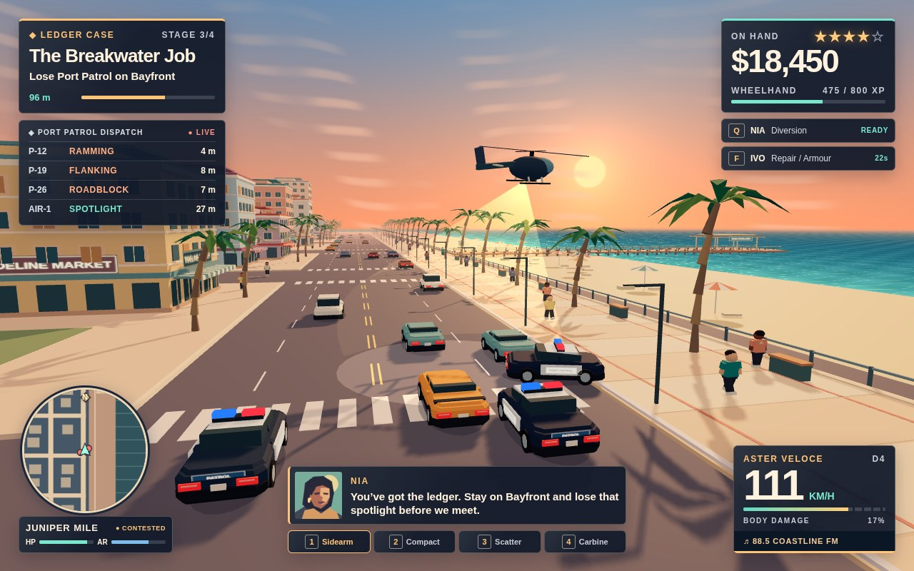

# Harbor Bay

Harbor Bay is an offline third-person crime game set on the Juniper Mile waterfront. Fixer Nia and mechanic Ivo help you steal a Port Authority ledger that links a missing freighter to a string of payoffs. Follow the six-mission case, race down Bayfront, run courier jobs along the promenade, or take your chances with Port Patrol.

## Play

Run `node serve.ts` with Node.js 22 or newer and open `http://localhost:8080` in desktop Chrome. Choose **New Game** to meet Nia. **Continue** restores your last saved location and story stage. The game saves after stage transitions and allows manual saves from the pause menu.

| Input | Action |
| --- | --- |
| W, A, S, D | Move or drive |
| Shift / Space | Sprint / handbrake |
| E | Enter, steal, or exit a nearby car |
| Right mouse | Aim and turn the foot camera |
| Left mouse | Fire while on foot |
| 1–4 | Sidearm, Compact, Scatter, Carbine |
| Q / F | Nia's diversion / Ivo's repair or armour |
| R / C | Start the Juniper Circuit in a car / start the Pier Courier on foot |
| T | Cycle radio stations |
| Esc | Pause or resume |

## Source map

| Path under `game/src/` | Job |
| --- | --- |
| `main.js`, `core/` | Browser loop, input, chase camera, scripted captures |
| `world/` | Street grid, façades, coastal props, atmosphere and ocean |
| `vehicles/`, `actors/` | Car models, arcade driving, traffic and pedestrians |
| `police/`, `combat/` | Port Patrol tactics, air support and weapons |
| `missions/` | Ledger case, activities and crew cooldowns |
| `ui/` | HUD, local map, dialogue portraits and menus |
| `audio/`, `save/` | Synth radio, sound effects and local progression |

Run `MAKEFUN_OUTPUT_DIR=out node main.ts` to package the game and screenshots and generate `out/dossier.json`.
